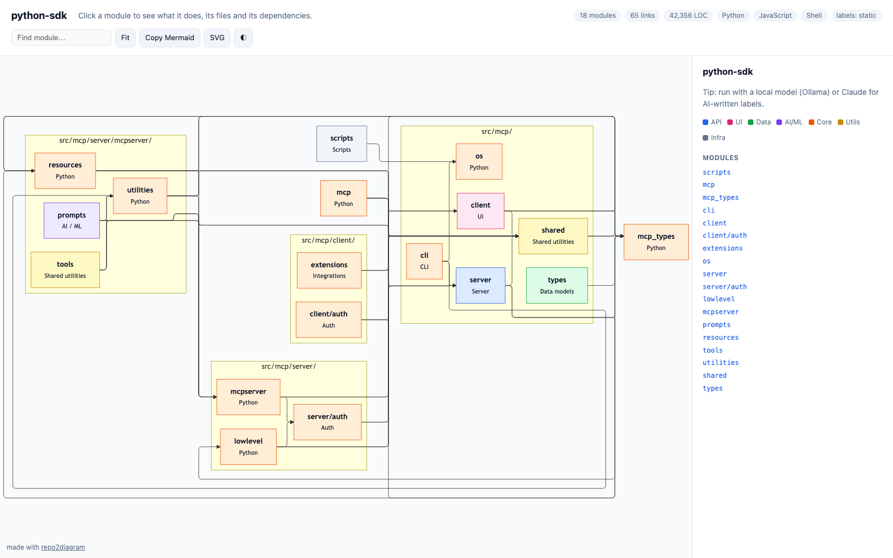

<div align="center">

# repo2diagram

**Turn any codebase into an interactive architecture diagram — in one command.**

Runs on your machine with local models (Ollama). Works as a **CLI**, an **MCP server** for Claude Code / Claude Desktop / Cursor, and an **agent skill**.

[](https://github.com/adityasingh-ops/repo2diagram/actions/workflows/ci.yml)
[](https://pypi.org/project/repo2diagram/)
[](LICENSE)



</div>

```bash
uvx repo2diagram modelcontextprotocol/python-sdk --open
```

## Why

Every new codebase starts with the same hour of clicking through folders to figure out what talks to what. `repo2diagram` reads the real import graph, groups files into modules, and (optionally) asks an LLM to label each one — so you get an accurate map, not a hallucinated one.

- **Real structure, not guesses** — modules and arrows come from static analysis of imports (Python, JS/TS incl. `tsconfig` path aliases, Go, Rust, Java/Kotlin/Scala, C#). The LLM only writes the labels.
- **Private by default** — works with local models via Ollama, or with no model at all. Your code never has to leave your machine.
- **Interactive** — click any box to see what it does, its files, what it uses and what uses it. Search, pan/zoom, dark mode, export SVG / Mermaid.
- **PR blast radius** — `--diff main` highlights the modules a branch touches **and every module that depends on them**, locally or as a GitHub Action comment on every PR.
- **Works in your AI tools** — MCP server for Claude Code, Claude Desktop and Cursor; skill for coding agents.

## Install

```bash
pip install repo2diagram        # or: uv tool install repo2diagram / pipx install repo2diagram
```

Or run it without installing: `uvx repo2diagram`.

## Usage

```bash
repo2diagram                         # current directory → <name>-architecture.html
repo2diagram ~/code/my-app --open    # open in the browser when done
repo2diagram vercel/ai-chatbot       # any GitHub repo (owner/repo or URL)
repo2diagram --diff main             # highlight what this branch changed + its blast radius
repo2diagram -o ARCHITECTURE.md      # Markdown with a Mermaid diagram (renders on GitHub)
repo2diagram -f mermaid -o -         # raw Mermaid to stdout
repo2diagram -f json                 # the full graph for your own tooling
repo2diagram --no-llm                # static analysis only — instant, no model needed
```

| Flag | What it does |
|---|---|
| `-o, --output FILE` | Output path; format inferred from `.html` `.md` `.mmd` `.json` (`-` = stdout) |
| `--diff [REF]` | Mark modules changed since `REF` (default `main`) and everything that depends on them |
| `--no-llm` | Skip model calls, use heuristic labels |
| `--provider`, `--model` | Override the configured model for one run |
| `--all` | Also draw tests, docs, examples and CI folders |
| `--direction TD` | Top-down instead of left-to-right |
| `--open` | Open the HTML when done |

## Models

`repo2diagram` picks a model automatically: a running **Ollama** first, then **Claude** if `ANTHROPIC_API_KEY` is set, otherwise static labels. Configure it once with the CLI:

```bash
# Local (default) — free and private
ollama pull qwen2.5-coder:7b
repo2diagram config set provider ollama

# Claude
repo2diagram config set provider anthropic
repo2diagram config set api_key sk-ant-...          # or export ANTHROPIC_API_KEY

# Anything OpenAI-compatible: OpenAI, OpenRouter, LM Studio, vLLM, llama.cpp …
repo2diagram config set provider openai
repo2diagram config set base_url http://localhost:1234/v1
repo2diagram config set model qwen2.5-coder-7b-instruct
repo2diagram config set api_key ...                  # if the server needs one

repo2diagram config show      # keys are redacted
repo2diagram doctor           # what's installed and which model will be used
```

Settings live in `~/.config/repo2diagram/config.json` (`chmod 600`). Env vars `R2D_PROVIDER`, `R2D_MODEL`, `R2D_BASE_URL`, `R2D_API_KEY` override it. Labels are cached in `~/.cache/repo2diagram`, so re-runs are instant and only changed modules hit the model.

## Use it from Claude Code, Claude Desktop or Cursor (MCP)

```bash
repo2diagram setup claude-code --yes       # runs: claude mcp add repo2diagram -- repo2diagram mcp
repo2diagram setup claude-desktop --yes    # merges into claude_desktop_config.json (backup kept)
repo2diagram setup cursor --yes            # merges into ~/.cursor/mcp.json
```

Or add it by hand:

```json
{ "mcpServers": { "repo2diagram": { "command": "uvx", "args": ["repo2diagram", "mcp"] } } }
```

Then just ask: *"Draw the architecture of this repo"*, *"What's the blast radius of my branch vs main?"*, *"Explain the `server/auth` module"*.

| Tool | Purpose |
|---|---|
| `diagram_repo` | Mermaid diagram + module table (+ saves the interactive HTML) |
| `repo_structure` | Modules, import edges, entry points and dependencies as JSON |
| `module_details` | One module in depth: files, uses / used-by, key file excerpts |
| `diff_impact` | Changed modules and their blast radius vs a git ref |

Inside an MCP client no API key is needed — the tools return the structure and your assistant does the explaining. Pass `summarize: true` to use your configured model instead.

## Blast radius on every pull request (GitHub Action)

Post a diagram of what each PR touches — and which modules depend on it — as a PR comment that updates on every push.

```yaml
# .github/workflows/architecture.yml
name: Architecture impact
on: pull_request
permissions:
  contents: read
  pull-requests: write
jobs:
  impact:
    runs-on: ubuntu-latest
    steps:
      - uses: actions/checkout@v4
        with:
          fetch-depth: 0
      - uses: adityasingh-ops/repo2diagram@v0
```

Locally, the same report is `repo2diagram --diff main -f pr`.

## Use it as an agent skill

Copy [`skills/repo2diagram`](skills/repo2diagram) into `~/.claude/skills/` (or your agent's skills folder). The agent will reach for it whenever you ask for an architecture overview or a PR impact check.

## How it works

1. **Scan** — list files (respects `.gitignore`), skip vendored and generated folders.
2. **Group** — open up container folders (`src/`, `packages/`, `apps/` …) until the repo splits into a readable set of modules; flat packages are drawn file by file.
3. **Link** — parse imports (Python AST, JS/TS with `tsconfig` aliases per package, Go modules, Rust `mod`/`use` across workspace crates, JVM packages, C# namespaces) and count module-to-module references.
4. **Label** — heuristics, or one small LLM call per module (cached by content hash).
5. **Render** — Mermaid with the ELK layout engine, wrapped in a single self-contained HTML file.

## Python API

```python
from repo2diagram import build_graph
from repo2diagram.render import render

graph, diff = build_graph("path/to/repo", summarize_with_llm=False, diff_base="main")
print(render(graph, "mermaid"))
```

## Contributing

```bash
git clone https://github.com/adityasingh-ops/repo2diagram && cd repo2diagram
uv sync && uv run pytest
```

More import resolvers (Ruby, PHP, Swift, Dart, C/C++) are the most wanted contributions — see `resolvers.py`.

## License

MIT
