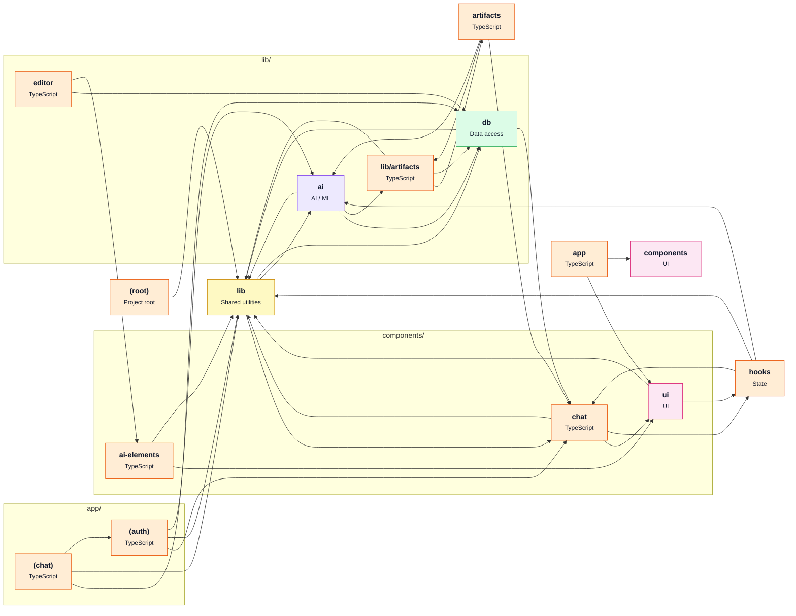

# [vercel/ai-chatbot](https://github.com/vercel/ai-chatbot) — architecture

Snapshot of commit `c2f8235`, generated with `repo2diagram vercel/ai-chatbot -f md`.

| Module | Role | What it does | Files | LOC |
|---|---|---|---|---|
| `.` | Project root |  | 18 | 246 |
| `app` |  |  | 3 | 86 |
| `app/(auth)` |  |  | 8 | 399 |
| `app/(chat)` |  |  | 16 | 1105 |
| `artifacts` |  |  | 8 | 844 |
| `components` | UI |  | 1 | 8 |
| `components/ai-elements` |  |  | 9 | 3182 |
| `components/chat` |  |  | 44 | 8419 |
| `components/ui` | UI |  | 22 | 2572 |
| `hooks` | State |  | 7 | 687 |
| `lib` | Shared utilities |  | 5 | 359 |
| `lib/ai` | AI / ML |  | 11 | 1061 |
| `lib/artifacts` |  |  | 1 | 95 |
| `lib/db` | Data access |  | 6 | 843 |
| `lib/editor` |  |  | 5 | 674 |

**Key dependencies:** `@ai-sdk/otel`, `@ai-sdk/provider`, `@ai-sdk/react`, `@codemirror/lang-python`, `@codemirror/state`, `@codemirror/theme-one-dark`, `@codemirror/view`, `@opentelemetry/api`, `@opentelemetry/api-logs`, `@radix-ui/react-use-controllable-state`, `@streamdown/cjk`, `@streamdown/code`, `@streamdown/math`, `@streamdown/mermaid`, `@vercel/analytics`, `@vercel/blob`, `@vercel/functions`, `@vercel/otel`, `ai`, `bcrypt-ts`

_Generated by [repo2diagram](https://github.com/adityasingh-ops/repo2diagram)_
