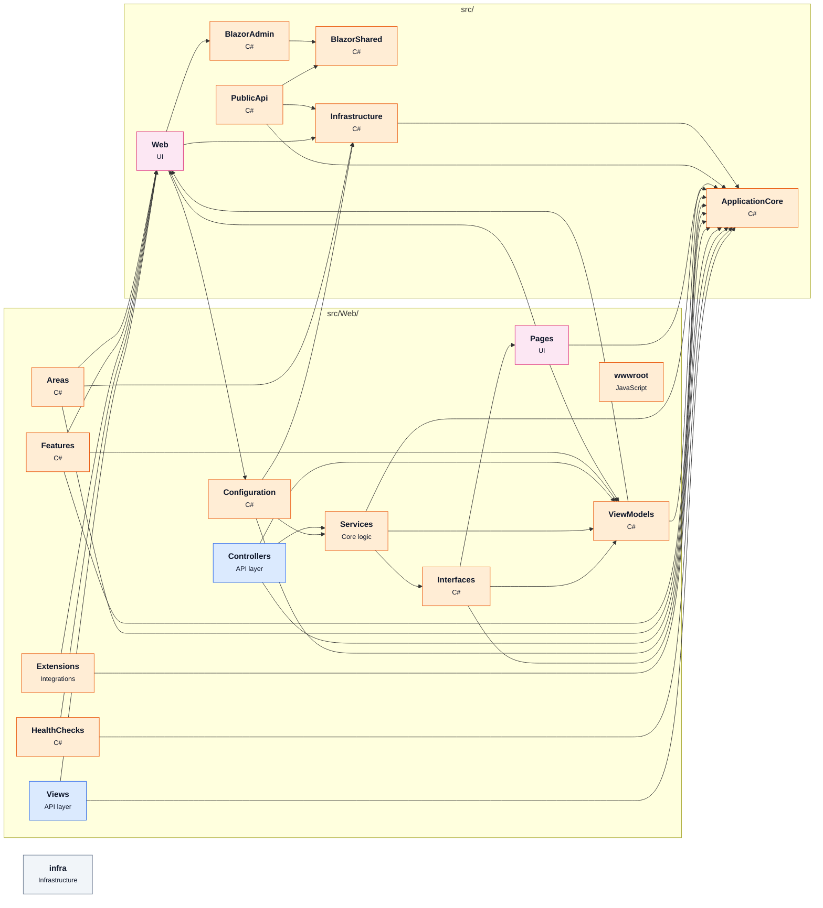

# [dotnet-architecture/eShopOnWeb](https://github.com/dotnet-architecture/eShopOnWeb) — architecture

Snapshot of commit `4da8212`, generated with `repo2diagram dotnet-architecture/eShopOnWeb -f md`.

| Module | Role | What it does | Files | LOC |
|---|---|---|---|---|
| `infra` | Infrastructure |  | 8 | 0 |
| `src/ApplicationCore` |  |  | 42 | 792 |
| `src/BlazorAdmin` |  |  | 50 | 969 |
| `src/BlazorShared` |  |  | 21 | 290 |
| `src/Infrastructure` |  |  | 31 | 2923 |
| `src/PublicApi` |  |  | 42 | 1070 |
| `src/Web` | UI |  | 13 | 228 |
| `src/Web/Areas` |  |  | 13 | 329 |
| `src/Web/Configuration` |  |  | 4 | 126 |
| `src/Web/Controllers` | API layer |  | 4 | 708 |
| `src/Web/Extensions` | Integrations |  | 3 | 51 |
| `src/Web/Features` |  |  | 4 | 107 |
| `src/Web/HealthChecks` |  |  | 2 | 69 |
| `src/Web/Interfaces` |  |  | 3 | 33 |
| `src/Web/Pages` | UI |  | 25 | 413 |
| `src/Web/Services` | Core logic |  | 4 | 282 |
| `src/Web/ViewModels` |  |  | 20 | 278 |
| `src/Web/Views` | API layer |  | 27 | 34 |
| `src/Web/wwwroot` |  |  | 68 | 1 |

_Generated by [repo2diagram](https://github.com/adityasingh-ops/repo2diagram)_
