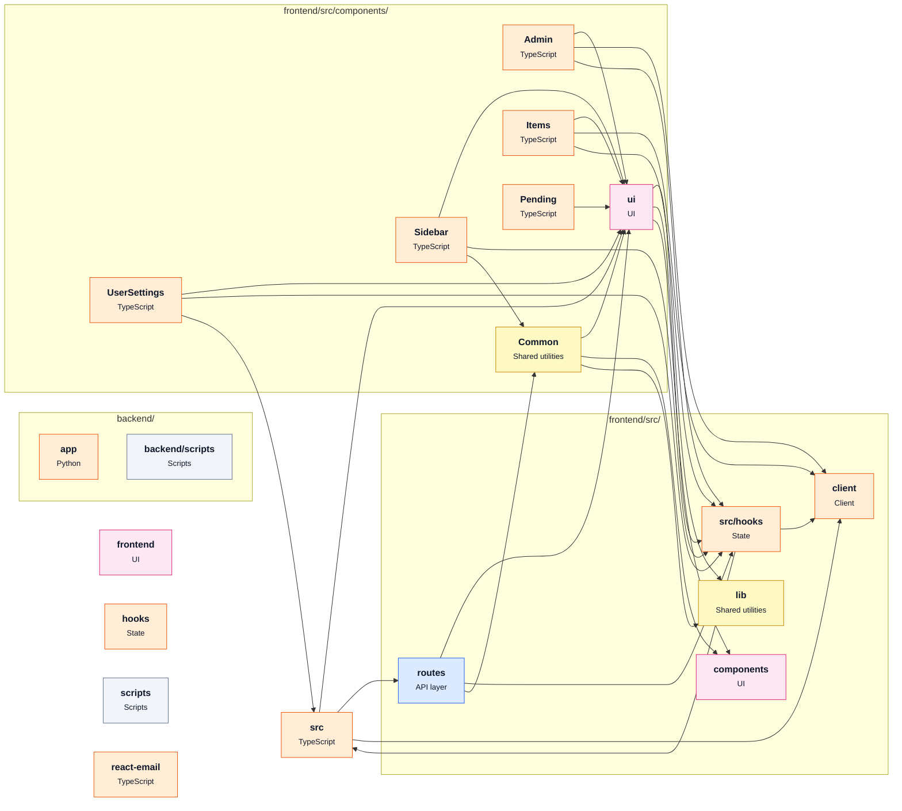

# [fastapi/full-stack-fastapi-template](https://github.com/fastapi/full-stack-fastapi-template) — architecture

Snapshot of commit `f4bcfab`, generated with `repo2diagram fastapi/full-stack-fastapi-template -f md`.

| Module | Role | What it does | Files | LOC |
|---|---|---|---|---|
| `backend/app` |  |  | 31 | 1513 |
| `backend/scripts` | Scripts |  | 5 | 37 |
| `frontend` | UI |  | 15 | 142 |
| `frontend/src` |  |  | 5 | 329 |
| `frontend/src/client` | Client |  | 16 | 2976 |
| `frontend/src/components` | UI |  | 1 | 115 |
| `frontend/src/components/Admin` |  |  | 5 | 688 |
| `frontend/src/components/Common` | Shared utilities |  | 7 | 495 |
| `frontend/src/components/Items` |  |  | 5 | 490 |
| `frontend/src/components/Pending` |  |  | 2 | 99 |
| `frontend/src/components/Sidebar` |  |  | 3 | 200 |
| `frontend/src/components/UserSettings` |  |  | 4 | 414 |
| `frontend/src/components/ui` | UI |  | 24 | 2658 |
| `frontend/src/hooks` | State |  | 4 | 140 |
| `frontend/src/lib` | Shared utilities |  | 1 | 6 |
| `frontend/src/routes` | API layer |  | 10 | 919 |
| `hooks` | State |  | 1 | 8 |
| `packages/react-email` |  |  | 11 | 388 |
| `scripts` | Scripts |  | 5 | 254 |

_Generated by [repo2diagram](https://github.com/adityasingh-ops/repo2diagram)_
