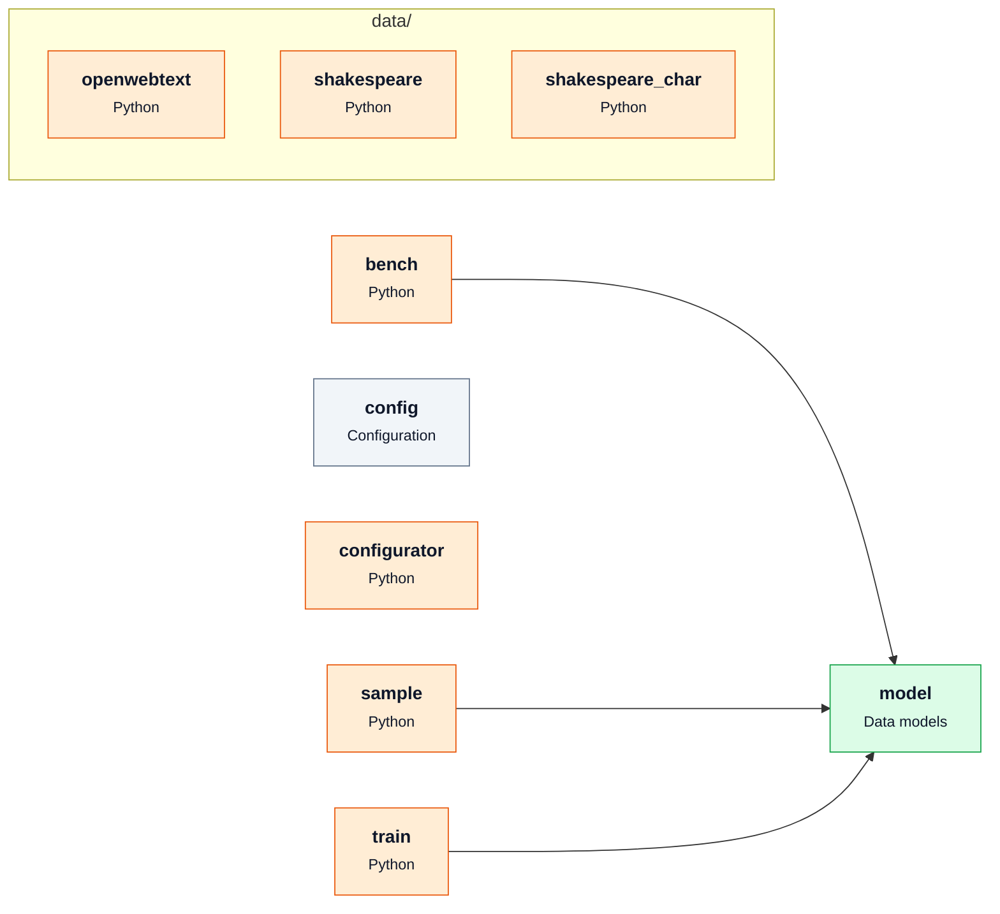

# [karpathy/nanoGPT](https://github.com/karpathy/nanoGPT) — architecture

Snapshot of commit `3adf61e`, generated with `repo2diagram karpathy/nanoGPT -f md`.

| Module | Role | What it does | Files | LOC |
|---|---|---|---|---|
| `bench` |  |  | 1 | 117 |
| `config` | Configuration |  | 7 | 119 |
| `configurator` |  |  | 1 | 47 |
| `data/openwebtext` |  |  | 2 | 81 |
| `data/shakespeare` |  |  | 2 | 33 |
| `data/shakespeare_char` |  |  | 2 | 68 |
| `model` | Data models |  | 1 | 330 |
| `sample` |  |  | 1 | 89 |
| `train` |  |  | 1 | 336 |

_Generated by [repo2diagram](https://github.com/adityasingh-ops/repo2diagram)_
