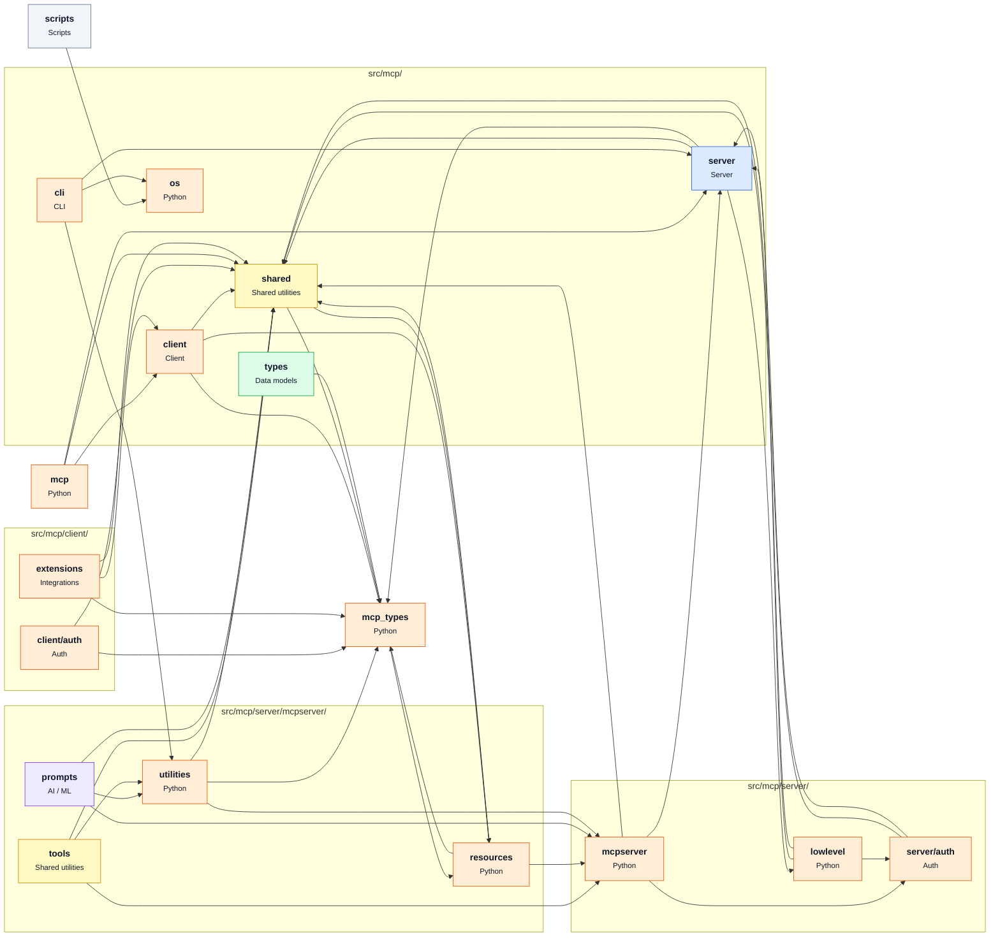

# [modelcontextprotocol/python-sdk](https://github.com/modelcontextprotocol/python-sdk) — architecture

Snapshot of commit `d7845c0`, generated with `repo2diagram modelcontextprotocol/python-sdk -f md`.

| Module | Role | What it does | Files | LOC |
|---|---|---|---|---|
| `scripts` | Scripts |  | 12 | 2983 |
| `src/mcp` |  |  | 2 | 145 |
| `src/mcp-types/mcp_types` |  |  | 9 | 10644 |
| `src/mcp/cli` | CLI |  | 3 | 662 |
| `src/mcp/client` | Client |  | 16 | 5655 |
| `src/mcp/client/auth` | Auth |  | 7 | 1899 |
| `src/mcp/client/extensions` | Integrations |  | 2 | 173 |
| `src/mcp/os` |  |  | 5 | 358 |
| `src/mcp/server` | Server |  | 23 | 6635 |
| `src/mcp/server/auth` | Auth |  | 16 | 1825 |
| `src/mcp/server/lowlevel` |  |  | 3 | 866 |
| `src/mcp/server/mcpserver` |  |  | 5 | 2797 |
| `src/mcp/server/mcpserver/prompts` | AI / ML |  | 3 | 293 |
| `src/mcp/server/mcpserver/resources` |  |  | 5 | 684 |
| `src/mcp/server/mcpserver/tools` | Shared utilities |  | 3 | 306 |
| `src/mcp/server/mcpserver/utilities` |  |  | 5 | 877 |
| `src/mcp/shared` | Shared utilities |  | 27 | 5484 |
| `src/mcp/types` | Data models |  | 4 | 70 |

_Generated by [repo2diagram](https://github.com/adityasingh-ops/repo2diagram)_
