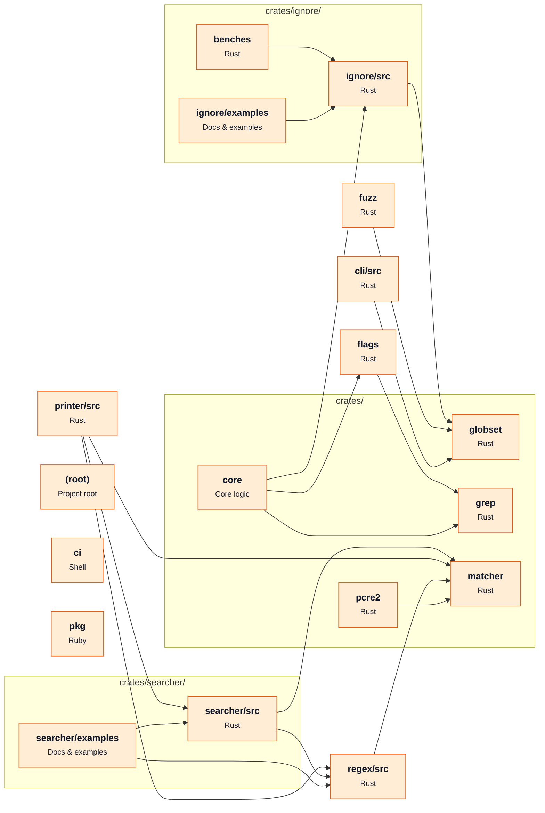

# [BurntSushi/ripgrep](https://github.com/BurntSushi/ripgrep) — architecture

Snapshot of commit `91f5d22`, generated with `repo2diagram BurntSushi/ripgrep -f md`.

| Module | Role | What it does | Files | LOC |
|---|---|---|---|---|
| `.` | Project root |  | 17 | 73 |
| `ci` |  |  | 4 | 107 |
| `crates/cli/src` |  |  | 8 | 1866 |
| `crates/core` | Core logic |  | 6 | 1303 |
| `crates/core/flags` |  |  | 21 | 11854 |
| `crates/globset` |  |  | 11 | 3556 |
| `crates/grep` |  |  | 7 | 90 |
| `crates/ignore/benches` |  |  | 2 | 587 |
| `crates/ignore/examples` | Docs & examples |  | 1 | 64 |
| `crates/ignore/src` |  |  | 9 | 8752 |
| `crates/matcher` |  |  | 9 | 2041 |
| `crates/pcre2` |  |  | 7 | 569 |
| `crates/printer/src` |  |  | 13 | 9320 |
| `crates/regex/src` |  |  | 9 | 2782 |
| `crates/searcher/examples` | Docs & examples |  | 1 | 34 |
| `crates/searcher/src` |  |  | 10 | 6496 |
| `fuzz` |  |  | 5 | 22 |
| `pkg` |  |  | 3 | 23 |

**Key dependencies:** `anyhow`, `bstr`, `grep`, `ignore`, `lexopt`, `log`, `serde_json`, `termcolor`, `textwrap`

_Generated by [repo2diagram](https://github.com/adityasingh-ops/repo2diagram)_
