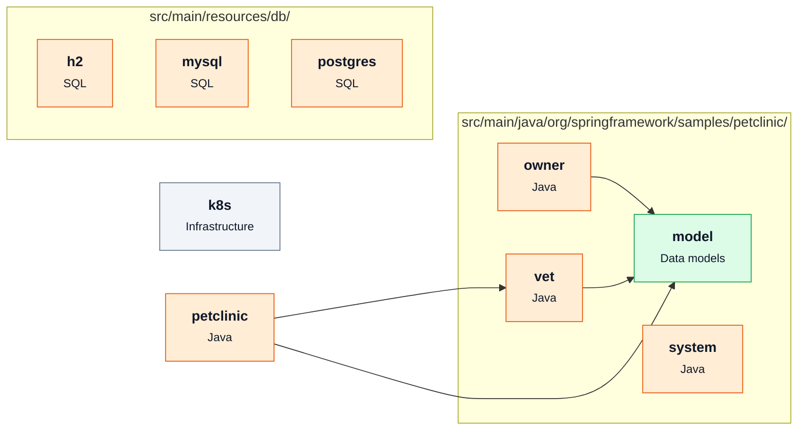

# [spring-projects/spring-petclinic](https://github.com/spring-projects/spring-petclinic) — architecture

Snapshot of commit `500158f`, generated with `repo2diagram spring-projects/spring-petclinic -f md`.

| Module | Role | What it does | Files | LOC |
|---|---|---|---|---|
| `k8s` | Infrastructure |  | 2 | 0 |
| `src/main/java/org/springframework/samples/petclinic` |  |  | 3 | 90 |
| `src/main/java/org/springframework/samples/petclinic/model` | Data models |  | 4 | 179 |
| `src/main/java/org/springframework/samples/petclinic/owner` |  |  | 12 | 1130 |
| `src/main/java/org/springframework/samples/petclinic/system` |  |  | 5 | 196 |
| `src/main/java/org/springframework/samples/petclinic/vet` |  |  | 6 | 304 |
| `src/main/resources/db/h2` |  |  | 2 | 118 |
| `src/main/resources/db/mysql` |  |  | 4 | 120 |
| `src/main/resources/db/postgres` |  |  | 3 | 106 |

_Generated by [repo2diagram](https://github.com/adityasingh-ops/repo2diagram)_
